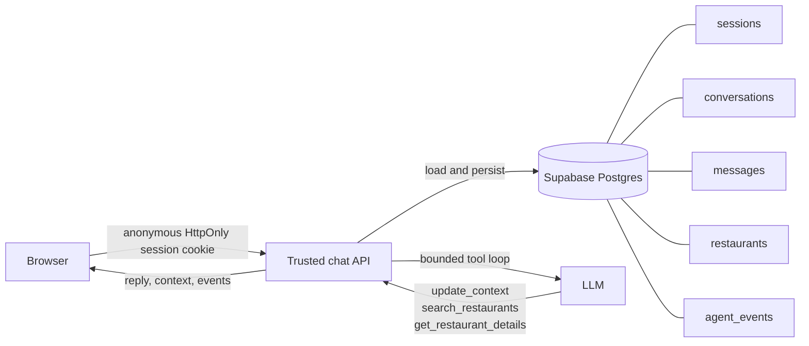

# Restaurant Concierge Architecture

The browser never queries the database with a service credential. The trusted API validates the anonymous session, owns tool execution, and records the user-visible execution trace.
