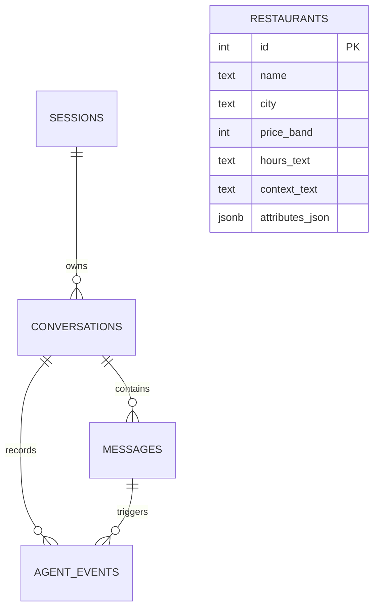

# Restaurant Concierge — Design Document

Status: proposed implementation scope. No application has been built yet.

## 1. Goal

Build a conversational web app that helps someone decide where to eat from the 50 supplied restaurants. The agent learns preferences, handles changes of mind, and recommends one clear choice with an explanation grounded in restaurant records.

The engineering focus is context management, useful follow-up questions, reliable tool execution, and visible activity. The first frontend version uses mock responses while the database is being configured.

## 2. Assignment and deliverables

The supplied brief requires natural conversation, complete restaurant recommendations, accumulating user context, and displayed/logged tool calls and context changes. The time limit is five hours from receipt of the brief.

Submission must include an accessible repository, a working deployed URL, the exported agent prompt, and a database architecture diagram. All four belong in one submission email.

## 3. Locked scope

| Build | Behavior |
| --- | --- |
| Conversational chat | Accept fragments, unrelated answers, corrections, and changing plans |
| Restaurant recommendation | One primary choice; optional backup; explain fit and caveats |
| Context panel | Show persistent preferences separately from the current outing |
| Context editing | Let the user correct or remove saved information |
| Activity panel | Display actual tool arguments, results, errors, and context diffs |
| Persistence | Restore messages and context after refresh |
| Anonymous session | No sign-up; backend-issued session credential |
| Basic recovery | Loading, failed request, and no-match states |

Out of scope: reservations, payments, SMS integration, live availability, external restaurant APIs, maps, authentication screens, multi-user group chat, and vector search. These can be revisited after the required deployed flow works.

## 4. User interface

Desktop: chat as the primary area, with a secondary panel containing “What I know” and collapsible “Agent activity.” On mobile, those panels are drawers or tabs. The recommendation card appears in the conversation.

Opening message: “What are you in the mood for?” Example request buttons submit ordinary messages, such as “Cheap dinner in Irvine,” “Somewhere quiet for a date,” and “Dinner for a group with a vegan.” They are optional shortcuts rather than a required questionnaire.

Recommendation card: name, cuisine, price range, address, listed hours, a short explanation of fit, and relevant limitations. Use the supplied price bands; do not invent exact meal costs, ratings, photos, or wait times.

“New conversation” clears the outing context and starts a new chat while retaining explicitly saved preferences. A separate “Forget saved preferences” action clears durable memory. Browser refresh restores the current conversation.

During a request, show a loading indicator and prevent overlapping submissions. On failure, retain the user's message and offer Retry. No matches produce a conversational explanation and a question about one changeable constraint.

## 5. Agent behavior

Every message goes through the agent, but each message does not require restaurant retrieval. The agent can ask a question, update context, search, inspect restaurant details, or recommend.

Ask one useful question at a time. Ask only when the answer could materially change the recommendation. If enough information is already available, search immediately. Do not require every preference field to be filled.

Explicit requirements outrank inferred preferences. Never silently relax dietary requirements, budget limits, or other hard constraints. If there is no suitable match, ask which flexible preference the user wants to change.

Examples:

- “Actually, budget doesn't matter” replaces the previous budget restriction while preserving location and dietary requirements.
- “My girlfriend is vegan tonight” describes a companion for this outing; it does not make the user permanently vegan.
- “I’m vegan” can become a durable preference with the user's message recorded as its source.
- “Somewhere quiet” is an outing preference unless the user makes it a general preference.
- A vegan menu requiring 48 hours' notice is not a confirmed same-night option.

Recommendations must reference restaurants returned by tools. Describe listed hours as supplied data, not verified live status. Resolve dates and times in America/Los_Angeles; ask if the intended time is unclear. Do not claim reservation availability or allergy safety.

## 6. Runtime flow

1. Backend validates the session, conversation ownership, message size, and request ID.
2. Save the user message and load recent messages, durable preferences, and outing context.
3. Send that state and available tool schemas to the LLM.
4. If the LLM requests a tool, validate arguments, log the request, execute it, and log its result or error.
5. Feed the actual tool result back to the LLM. Continue within a bounded tool loop.
6. Validate any recommendation IDs against retrieved records and enforce supported hard constraints.
7. Save the assistant response and return the reply, recommendation, current context, and ordered events.

The LLM interprets language and chooses actions. The backend owns database access, schema validation, session isolation, persistence, and execution limits. Cap a turn at six tool calls and a configured timeout. A failed search must not be presented as “no matches.”

### Model integration

Use OpenRouter through the OpenAI JavaScript SDK, without an agent framework.

| Setting | Value |
| --- | --- |
| OpenAI SDK base URL | `https://openrouter.ai/api/v1` |
| Default model | `openai/gpt-4.1-mini` |
| Backend API key variable | `OPENROUTER_API_KEY` |
| Backend model variable | `OPENROUTER_MODEL` |

Instantiate the SDK only in the trusted backend with `OPENROUTER_API_KEY` and the OpenRouter base URL. `OPENROUTER_MODEL` defaults to `openai/gpt-4.1-mini` when it is not otherwise configured. No model calls or model credentials may be exposed to the browser.

The backend implements a small, explicit tool-calling loop:

1. Load the conversation history, saved preferences, and current outing context from Supabase.
2. Send the system prompt, loaded messages, context, and tool definitions to the model.
3. Validate each requested tool call and execute it in the backend.
4. Persist the tool request/result or context change as an agent event, then send the result back to the model.
5. Repeat until the model returns an assistant reply, with no more than six tool calls in one user turn.
6. Persist the final reply and return the reply, recommendation, context, and ordered events to the client.

The model can request tools but cannot query Supabase or mutate data directly. Tool validation failures are returned to the model as structured errors within the same bounded turn.

## 7. Tools

| Tool | Purpose |
| --- | --- |
| update_context | Apply validated set/remove operations to durable or outing context; include source message and whether the value is explicit or inferred |
| search_restaurants | Query structured filters such as city, price band, cuisine, and supported dietary attributes; return a bounded candidate list with original context |
| get_restaurant_details | Retrieve the full record for a known restaurant ID |

The backend supplies the conversation ID; the model cannot choose another user's session. Database queries are parameterized. Context editing in the UI uses the same validated persistence path and creates an event.

The frontend continues to use mock responses while its interaction flow is under development. The mock activity panel must remain visibly marked as simulated. Before deployment, replace the mock transport with the backend endpoint and display the persisted, actual tool calls and context diffs returned by that endpoint.

Dietary tags distinguish confirmed options, options requiring modification or advance notice, and unknown information. The original description stays available so conditions are not lost. For the MVP, use structured SQL filters plus the full candidate descriptions for nuanced selection.

## 8. Data and Supabase schema

Supabase Postgres stores the data. All writes and queries go through the backend; service credentials never appear in browser code. A browser receives an opaque session token, preferably in a secure HttpOnly cookie. A UUID alone is not authorization.

| Table | Essential fields | Purpose |
| --- | --- | --- |
| sessions | id, token_hash, preferences_json, created_at, updated_at | Anonymous identity and durable preferences |
| conversations | id, session_id FK, outing_context_json, created_at, updated_at | Current outing state |
| messages | id, conversation_id FK, request_id, role, content, created_at | Conversation transcript |
| restaurants | id, name, address, city, cuisine_tags, price_band, hours_text, context_text, attributes_json | Seeded catalog |
| agent_events | id, conversation_id FK, message_id FK, sequence, type, payload_json, created_at | Tool activity and context changes |



Restaurant IDs appear in search results and recommendation event payloads. The catalog has no required ownership relationship to conversations. If saved recommendations become a feature later, add a recommendations table with explicit foreign keys.

Indexes: conversations(session_id), messages(conversation_id, created_at), agent_events(conversation_id, sequence), and restaurants(city, price_band). Use a unique user-message request ID per conversation to prevent duplicate submission on retry. Persist context updates and their corresponding events together in a transaction.

JSONB keeps small, evolving context fields easy to change without adding a table for every preference. Conversation and message relationships remain relational. No embeddings are required for the supplied 50-record catalog.

Seed all 50 records with stable IDs. Preserve raw hours and context. Validate the record count and required fields. The file is labeled Orange County but includes addresses in Long Beach and Norwalk; use actual city fields rather than excluding those records.

## 9. Frontend/backend contract

Start with one non-streaming chat endpoint. The frontend depends on this contract, whether its transport is mocked or real:

```json
{
  "request": {
    "conversation_id": "uuid",
    "request_id": "uuid",
    "message": "Cheap vegan dinner in Irvine"
  },
  "response": {
    "conversation_id": "uuid",
    "reply": "Assistant response",
    "recommendation": null,
    "context": { "preferences": {}, "outing": {} },
    "events": []
  }
}
```

Recommendation object: restaurant_id, grounded restaurant fields, reasons, caveats, and an optional backup. Event object: id, sequence, type, status, tool_name when applicable, input/output when applicable, context diff when applicable, and timestamp. Expose actual execution metadata, not hidden chain-of-thought.

Endpoints: POST /api/conversations, GET /api/conversations/:id, POST /api/chat, PATCH /api/context. Session initialization can be handled when creating the first conversation. Mock mode must be visibly labeled, with its events marked simulated; deployed submission mode must use real execution.

## 10. Failure handling and validation

- Invalid tool arguments: return a structured error to the agent for correction within the turn limit.
- Empty results: explain the constraint conflict and ask before relaxing anything.
- Database/model failure: display an error and keep the conversation recoverable; do not fabricate results.
- Retry: reuse the request ID. Completed requests return their saved response. Pending/failed requests follow recorded status rather than appending another user message.
- Unsupported recommendation: reject nonexistent IDs and choices that violate validated hard filters.
- Conflicting memory: prefer explicit corrections, record the change, and ask if ambiguity matters.

Manual acceptance scenarios: vague opening; complete opening; fragments and off-question answers; changed budget; companion dietary requirement; no match; advance-notice caveat; database failure; refresh restoration; retry without duplicate message; new conversation retaining preferences; user correction reflected in the next search. Check that activity shown in the UI matches persisted events.

## 11. Implementation and five-hour budget

Suggested default: TypeScript web app with frontend and backend routes in one deployment, Supabase Postgres, and OpenRouter accessed through the OpenAI JavaScript SDK. Implement tool calling with the explicit backend loop described above; do not add an agent framework. Keep the provider configuration isolated to the backend and export the prompt as agent-prompt.md.

| Budget | Work |
| --- | --- |
| 45 minutes | Schema and seed; basic chat layout with mock transport |
| 90 minutes | Backend agent loop, validated tools, context persistence |
| 60 minutes | Recommendation card, context editing, activity panel |
| 45 minutes | Recovery states and acceptance scenarios |
| 60 minutes | Deploy, verify live flow, export prompt/diagram, prepare submission |

Deploy a minimal working version early. If time is tight, defer context editing and the backup recommendation before cutting required conversation behavior, context logging, deployment, or deliverables.

## 12. Definition of done

A reviewer can open the deployed app, converse naturally, change a preference, get a grounded restaurant recommendation, refresh without losing the conversation, and inspect the tool results and context updates that produced it. The repository, live URL, exported prompt, and architecture diagram are ready for submission.

Source brief: A Really Fun Project.pdf. Source catalog: restaurants.txt. This document specifies proposed behavior; it does not claim that implementation or deployment is complete.
